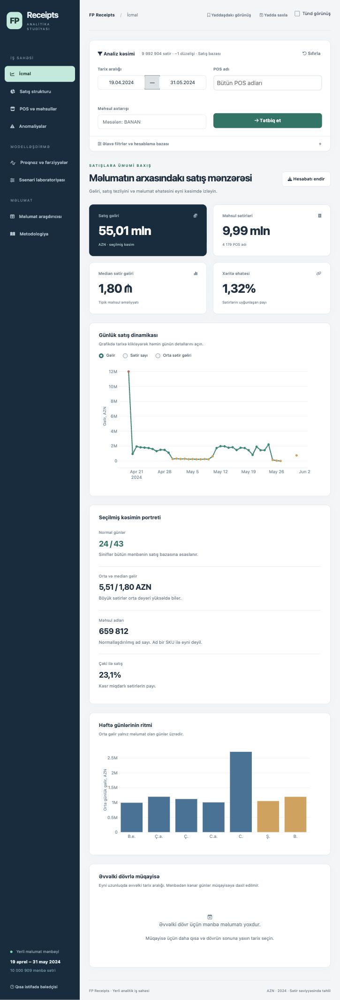

# FP Receipts — Ziyad

### Retail Sales Analytics Portfolio

A retail analytics case study built with **R, Shiny, data.table and Plotly**, covering **10,000,909 receipt line items**. The project combines exploratory analysis, data-quality diagnostics, chronological forecast validation and scenario modelling, with an interactive application and a 21-slide executive presentation.

**Portfolio müəllifi: Ziyad** · **Məlumat dövrü: 19 aprel – 31 may 2024**

Tətbiqin bütün R kodu, CSS dizaynı və JavaScript funksiyaları **bir [`FP_Receipts_Shiny.R`](FP_Receipts_Shiny.R) faylındadır**.



## Sürətli keçidlər

| Baxmaq istədiyiniz | Keçid |
| --- | --- |
| Tək fayldan işləyən tətbiq | [`FP_Receipts_Shiny.R`](FP_Receipts_Shiny.R) |
| 21 slayddan ibarət təqdimat | [`FP_Receipts_Teqdimat.pptx`](presentation/FP_Receipts_Teqdimat.pptx) |
| Tam R Markdown analizi | [`DA_Yekun_Layihe_Ziyad.Rmd`](docs/DA_Yekun_Layihe_Ziyad.Rmd) |
| Hazır HTML hesabatı | [`DA_Yekun_Layihe_Ziyad.html`](docs/DA_Yekun_Layihe_Ziyad.html) |
| Satış cədvəli, tam məlumat | [`fp_receipts.rds`](fp_receipts.rds) |
| Məhsul xəritəsi, tam məlumat | [`fp_map.rds`](fp_map.rds) |
| Cədvəllərin və sütunların izahı | [Data dictionary](docs/DATA_DICTIONARY.md) |
| Hesablamalar və məhdudiyyətlər | [Metodologiya](docs/METHODOLOGY.md) |
| Sınaq mühitinin paket versiyaları | [Environment](docs/ENVIRONMENT.md) |

HTML hesabatını GitHub-dan **Download raw file** ilə endirib brauzerdə açın. Təqdimatı endirib PowerPoint-də açmaq mümkündür. İnteraktiv Shiny tətbiqini işlətmək üçün aşağıdakı R quraşdırma addımlarını izləyin.

## Layihənin məqsədi

Layihə satış həcmi və gəlirin strukturunu araşdırır, böyük və natamam məlumatın qərarlara təsirini göstərir, proqnozu sadə baza modelləri ilə müqayisə edir. Rəqəmlərlə yanaşı onların hansı məlumat bazasından hesablandığını da göstərmək əsas prinsipdir.

**Skills demonstrated:** large-data preparation, text-encoding repair, product/POS-name normalisation, interactive dashboard design, anomaly diagnostics, chronological model validation and communicating analytical limitations.

## İki məlumat cədvəli

| Xüsusiyyət | `fp_receipts` | `fp_map` |
| --- | --- | --- |
| Fayl | [`fp_receipts.rds`](fp_receipts.rds) | [`fp_map.rds`](fp_map.rds) |
| Sətir sayı | **10 000 909** | **118 118** |
| Sütun sayı | **6** | **4** |
| Məzmun | Məhsul əməliyyatları | Aylıq məhsul kateqoriyası və mənfəət marjası |
| Dövr | 19.04–31.05.2024, məlumatı olan 40 gün | 202403, 202404, 202405 |
| Fayl ölçüsü | 231 961 439 bayt, təxminən 221 MiB | 2 168 558 bayt, təxminən 2,07 MiB |
| Brauzerdə 10 sətirlik nümunə | [`fp_receipts_preview.csv`](data/fp_receipts_preview.csv) | [`fp_map_preview.csv`](data/fp_map_preview.csv) |

Tam RDS faylları reponun kökündə **Git LFS** ilə versiyalanır. CSV nümunələri yalnız ilk 10 xam sətri göstərir və tam məlumatı əvəz etmir. Xam məlumatın dəyərləri dəyişdirilməyib; düzəlişlər tətbiqdə hesablanır.

### `fp_receipts` sütunları

| Sütun | R tipi | İzah |
| --- | --- | --- |
| `pos` | character | POS/obyekt adı; unikal mağaza və ya filial identifikatoru deyil |
| `rec_date` | Date | Əməliyyatın tarixi |
| `rec_id` | character | Mənbədə sətir identifikatoru; eyni qəbzin məhsullarını qruplaşdırmağa kifayət etmir |
| `product_name` | character | Məhsulun xam adı; ümumi adlar və kodlaşdırma problemləri ola bilər |
| `qnt` | numeric | Xam miqdar; standart analizdə `qnt - 1` tətbiq olunur |
| `unit_price` | numeric | Xam vahid qiymət, AZN; standart analizdə `unit_price - 1` tətbiq olunur |

### `fp_map` sütunları

| Sütun | R tipi | İzah |
| --- | --- | --- |
| `period` | numeric | Ay açarı, `YYYYMM`; məsələn, `202404` |
| `product_type` | character | Mənbə kateqoriyası: `FOOD` və ya `NON-FOOD` |
| `product` | character | Xəritədəki məhsul adı |
| `profit_margin` | numeric | Mənfəət marjası nisbəti; `0.21` dəyəri 21%-dir |

**Əlaqə:** əməliyyat tarixindən çıxarılan ay + normallaşdırılmış məhsul adı. Eyni ay və məhsul açarının ilk xəritə sətri saxlanılır. Uyğunlaşdırma satış sətirlərinin təxminən **1,32%**-ni əhatə edir. Bu səbəbdən kateqoriya və mənfəət nəticələrinin təmsil gücü məhduddur. [Ətraflı sütun və əlaqə izahı](docs/DATA_DICTIONARY.md).

## Layihəni endirmək

### Variant A: Git LFS ilə klonlamaq

Əvvəlcə [Git LFS](https://git-lfs.com/) quraşdırın. Sonra terminalda:

```sh
git lfs install
git clone https://github.com/Ahmadzadaa/FP-Receipts.git
cd FP-Receipts
git lfs pull
```

Bu üsul tətbiqi və iki tam RDS faylını eyni qovluğa endirir. Böyük fayllar Git tarixçəsində kiçik istinadlarla izlənir və məzmunları LFS vasitəsilə alınır. [GitHub LFS izahı](https://docs.github.com/en/repositories/working-with-files/managing-large-files/about-git-large-file-storage).

### Variant B: Brauzerdən endirmək

1. **Code → Download ZIP** seçin və arxivi açın.
2. [`fp_receipts.rds`](fp_receipts.rds) və [`fp_map.rds`](fp_map.rds) səhifələrində **Download raw file** seçin. Alternativ olaraq [Releases → v1.1.0 → Assets](https://github.com/Ahmadzadaa/FP-Receipts/releases/tag/v1.1.0) bölməsindən iki RDS faylını endirin.
3. Hər iki faylı `FP_Receipts_Shiny.R` ilə eyni qovluğa qoyun.

ZIP arxivi LFS məzmunu əvəzinə kiçik göstərici faylı verə bilər. Əsl `fp_receipts.rds` təxminən 221 MiB, `fp_map.rds` isə 2,07 MiB-dır. Bir neçə yüz baytlıq mətn faylı RDS məlumatı deyil. Tətbiq belə halı aşkar edib `git lfs pull` və ya Releases-dən endirmə təlimatı göstərir.

GitHub CLI ilə alternativ:

```sh
gh repo clone Ahmadzadaa/FP-Receipts
cd FP-Receipts
gh release download v1.1.0 --repo Ahmadzadaa/FP-Receipts --pattern '*.rds'
```

## R və RStudio-da işə salmaq

**R 4.1 və ya daha yeni versiya** lazımdır. Layihə R 4.4.2 ilə yoxlanılıb. İlk hazırlıq mərhələsi 10 milyon sətirə görə vaxt və yaddaş tələb edir.

### 1. Paketləri quraşdırın

R konsolunda bir dəfə:

```r
install.packages(c(
  "shiny", "bslib", "plotly", "DT", "data.table",
  "stringr", "stringi", "htmltools", "jsonlite", "digest"
))
```

### 2. Tətbiqi açın

RStudio-da `FP_Receipts_Shiny.R` faylını açıb **Source** düyməsini basın. Konsolda alternativ:

```r
source("FP_Receipts_Shiny.R", encoding = "UTF-8")
```

Terminaldan:

```sh
Rscript FP_Receipts_Shiny.R
```

Tətbiq brauzerdə açılır. RStudio-da **Stop**, terminalda **Ctrl+C** ilə dayandırın. RDS faylları yalnız oxunur. İlk hazırlıqdan sonra istifadəçinin R keş qovluğunda yığcam baza saxlanılır; növbəti açılışlar bu keşdən istifadə edir.

Qovluq quruluşu:

```text
FP-Receipts/
├── FP_Receipts_Shiny.R
├── fp_receipts.rds
├── fp_map.rds
├── README.md
├── data/                    # 10 sətirlik CSV nümunələri, manifest və SHA-256
├── docs/                    # Ziyad Rmd/HTML hesabatı və izahlar
├── presentation/            # PowerPoint təqdimatı
└── assets/                  # Tətbiqin görüntüsü
```

### 3. Alternativ parametrlər

Məlumat başqa qovluqdadırsa, Source-dan əvvəl:

```r
Sys.setenv(FP_RECEIPTS_DATA_DIR = "/tam/yol/melumat_qovlugu")
```

| Parametr | Təyinat |
| --- | --- |
| `FP_RECEIPTS_DATA_DIR` | İki RDS faylının olduğu qovluq |
| `FP_SHINY_PORT` | Məsələn, `3847`; boş saxlananda uyğun port avtomatik seçilir |
| `FP_OPEN_BROWSER` | `0` olduqda brauzeri avtomatik açmır |
| `FP_RECEIPTS_CACHE_DIR` | Hazırlıq keşinin saxlanacağı qovluq |

GitHub layihəni saxlayır; Shiny üçün R prosesi işləməlidir. Tətbiq yerli `127.0.0.1` ünvanından açılır.

## Tətbiqdən istifadə

| Bölmə | Nə göstərir və nə etmək olar |
| --- | --- |
| **İcmal** | Gəlir, sətir sayı, median gəlir, xəritə əhatəsi; günlük qrafikdə nöqtəyə kliklə günün profili |
| **Satış strukturu** | Qiymət aralıqları və paylar; qiymət sütununa kliklə həmin aralığı bütün analizə tətbiq etmək |
| **POS və məhsullar** | Reytinq, minimum aktiv gün, Pareto, axtarış, obyekt müqayisəsi və kliklə profil |
| **Anomaliyalar** | Median hədlərini dəyişərək günlük siqnalları araşdırmaq və keyfiyyət cədvəlini endirmək |
| **Proqnoz və fərziyyələr** | Dörd model, dəyişən test/üfüq, MAE/RMSE/MAPE/WAPE, Wilcoxon və reqressiya intervalları |
| **Ssenari laboratoriyası** | Qiymət, həcm və marja fərziyyələri; gəlir təsiri və həssaslıq xəritəsi |
| **Məlumat araşdırıcısı** | İlk 1 000–100 000 sətrin seçilən limiti, axtarış, sıralama və CSV ixracı |
| **Metodologiya** | Hesablama bazası, mənbə izləri və nəticələrin məhdudiyyətləri |

Tarix, POS, məhsul mətni, kateqoriya, ədəd/çəki ayrımı, gün statusu və qiymət filtrlərini seçin. Qlobal dəyişiklikləri **Tətbiq et** və ya **Ctrl/Cmd+Enter** ilə təsdiqləyin. **Sıfırla** standart görünüşü qaytarır. Ssenari sürgüləri öz bölməsində dərhal işləyir.

**Yadda saxla** tətbiq edilmiş filtrləri həmin brauzerin yerli yaddaşında saxlayır. Tünd görünüş, mobil menyu, qrafik zoom/pan, PNG, CSV, filtr JSON-u və dörd əsas hissəli HTML hesabat ixracı mövcuddur.

## Analizin dörd əsas hissəsi

### 1. Deskriptiv təhlil

Standart baza `qnt - 1`, `unit_price - 1` düzəlişini tətbiq edir və avans/kredit ödənişlərini çıxarır. Bu bazada **9 992 904 məhsul sətri**, **55 011 469,69 AZN satış gəliri**, **1,80 AZN median sətir gəliri** var. Gəlir qiymət aralıqları, məhsul/POS adları və günlər üzrə araşdırılır.

### 2. Anomaliyalar

Mənbədə 43 təqvim gününün 40-da məlumat var: **24 normal**, **15 aşağı həcmli**, **1 yüksək həcmli gün**, **3 məlumatı olmayan tarix**. POS/məhsul adları və aşağı xəritə əhatəsi ayrıca yoxlanır. Statuslar diaqnostik siqnallardır; səbəbi sübut edən ETL qeydləri deyil.

### 3. Proqnoz və fərziyyələr

Standartda 24 normal günün son 5-i test, əvvəlki 19-u təlim üçün ayrılır. Reqressiya ilə sadə orta, son gün və həftə gününün ortası müqayisə olunur. Reqressiyanın test MAPE-si təxminən **38,3%**, MAE-si **441 614,6 AZN**-dir. Sadə orta modelinin MAE-si **411 575,8 AZN**-dir. Bu test reqressiyanın üstünlüyünü təsdiqləmir.

### 4. Xülasə

Qərarların keyfiyyəti məlumatın tamlığından və identifikatorlardan asılıdır. Növbəti addımlar: `-1` fərziyyəsini mənbə sistemi ilə təsdiqləmək, natamam günləri yoxlamaq, məhsul və POS kodlarını təkmilləşdirmək, daha uzun fasiləsiz tarixçədə proqnozu yenidən sınaqdan keçirmək.

Bu rəqəmlər standart filtrlərə aiddir; tətbiqdə filtr dəyişəndə nəticələr yenidən hesablanır. [Formullar, testlər və şərh qaydaları](docs/METHODOLOGY.md).

## Məlumatın bütövlüyü

Layihə qovluğunda macOS/Linux terminalında:

```sh
shasum -a 256 -c data/SHA256SUMS
```

Fayl ölçüləri və SHA-256 izləri [`data/manifest.json`](data/manifest.json) daxilindədir. LFS və Releases-dəki məlumatlar eyni xam fayllardır.

## Hesabatı yenidən yaratmaq

Hazır HTML-ni açmaq üçün R lazım deyil. Rmd-ni yenidən işlətmək istəsəniz, tətbiq paketlərinə əlavə olaraq:

```r
install.packages(c("rmarkdown", "dplyr", "tidyr", "ggplot2", "lubridate"))
Sys.setenv(FP_RECEIPTS_DATA_DIR = normalizePath("."))
rmarkdown::render("docs/DA_Yekun_Layihe_Ziyad.Rmd")
```

RStudio-da Pandoc adətən birlikdə gəlir. Bu addım böyük məlumatın bütün hesabatını yenidən hesablayır; Shiny-ni açmaq üçün lazım deyil.

## Yoxlamalar

Filtrlər, boş nəticə, xam/düzəlişli yekunlar, 12 qrafik, proqnoz və ssenari, HTML hesabatı və CSV ixracları yerli mühitdə yoxlanılıb. Tək `.R` faylının ayrıca qovluqdan açılması sınaqdan keçirilib. Tam cədvəllər üçün ölçü və SHA-256 uyğunluğu yoxlanılır.
